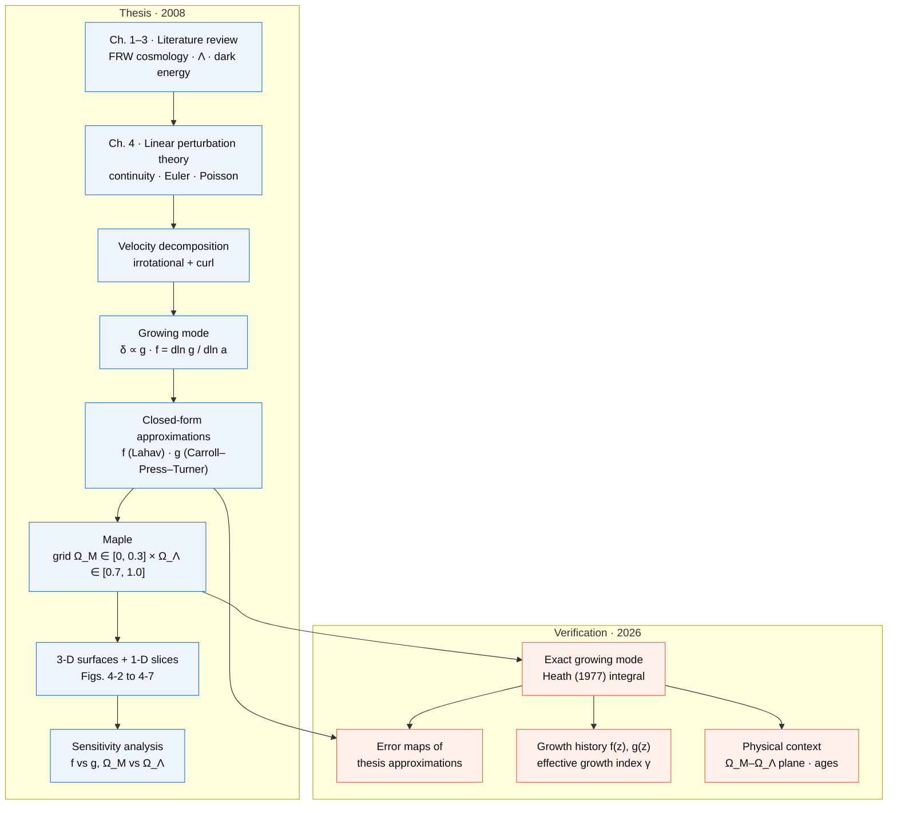
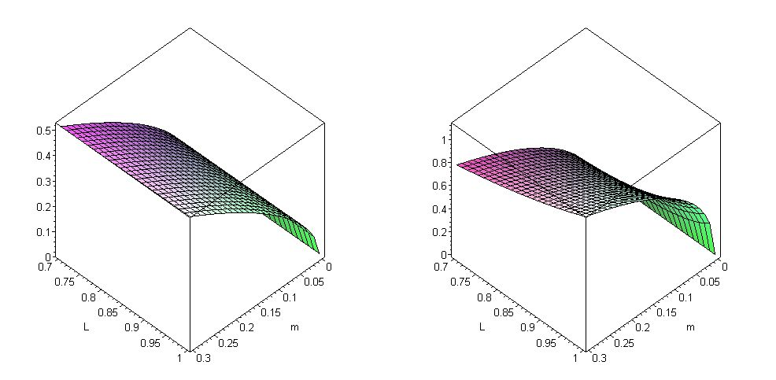
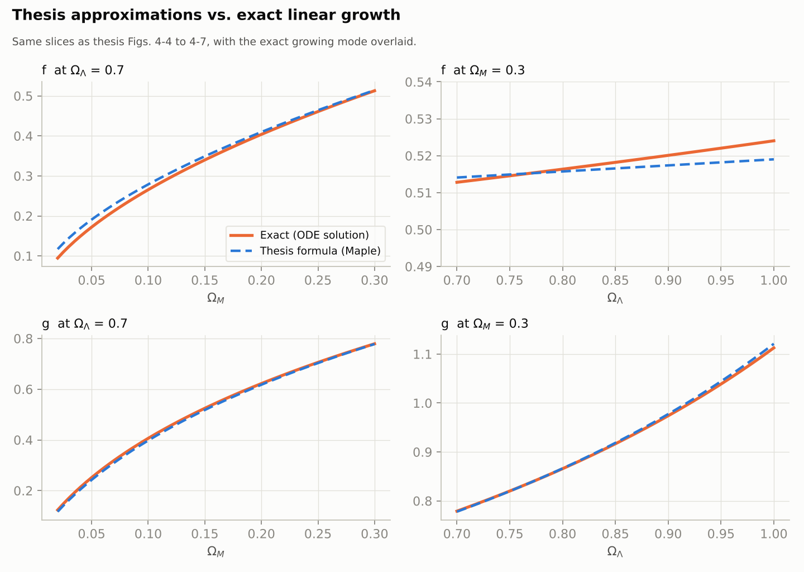
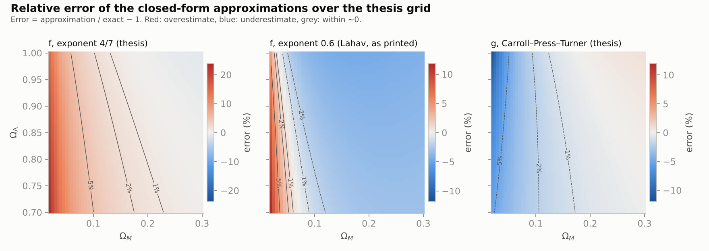
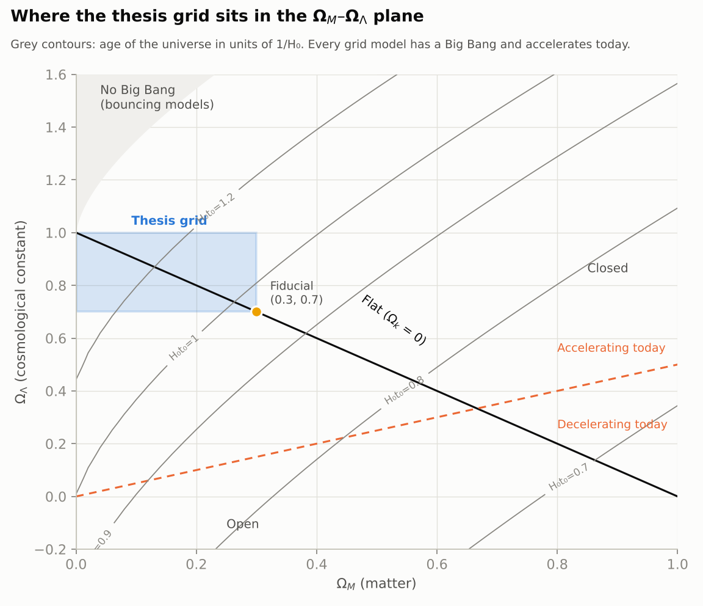
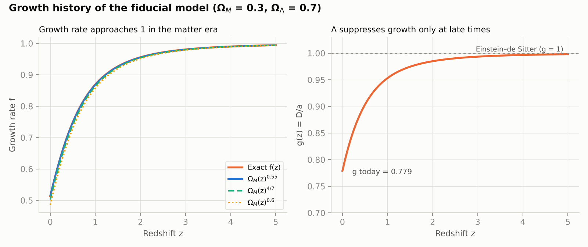
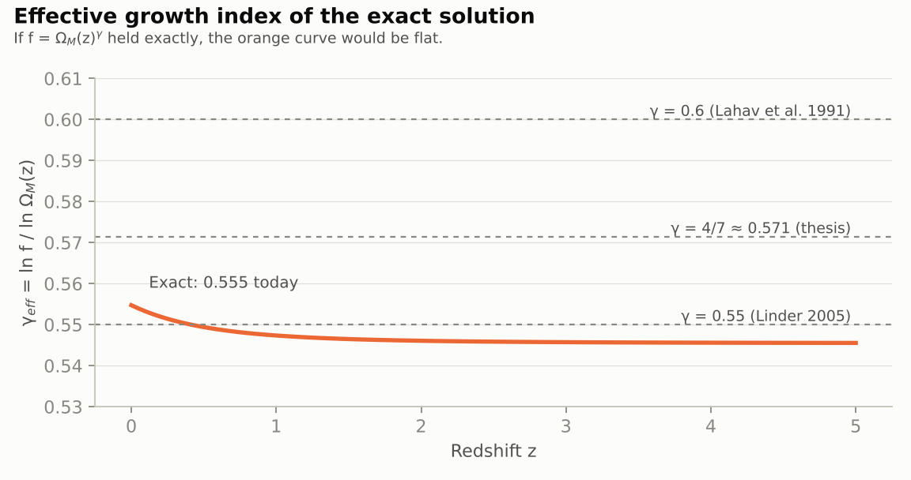

# Cosmological Growth Calculations in Maple

### Linear growth rate and growth factor of large-scale structure in a universe with a cosmological constant


MSc thesis **"Dark Energy and its Relation to the Cosmological Constant"**
Department of Physics, Faculty of Sciences · Bu-Ali Sina University, Hamadan, Iran · December 2008

| | |
|---|---|
| **Candidate** | Farhad Bayrami |
| **Supervisor** | Dr. A. Khodam-Mohammadi |
| **Adviser** | Dr. M. Amiri |
| **Full text** | [docs/thesis.pdf](docs/thesis.pdf) (124 pages, Persian, English abstract) |
| **This repository** | Thesis summary, the Maple growth calculations (Chapter 4), and an independent Python verification against the exact solution (2026) |

---

## Key Findings

| # | Finding | Source |
|---|---|---|
| 1 | Across $\Omega_\Lambda \in [0.7, 1.0]$ at $\Omega_M = 0.3$, the **growth rate $f$ barely moves** (+1.0 % in the thesis, +2.2 % exact), while the **growth factor $g$ changes by ~43 %**. Λ leaves the instantaneous rate of growth almost untouched but strongly reduces the accumulated amplitude. | Thesis, confirmed by exact solution |
| 2 | **The thesis approximations are accurate where they matter.** For $\Omega_M \ge 0.2$ the formulas used in Maple agree with the exact solution to within **1.4 %** for $f$ and **0.75 %** for $g$. | Verification |
| 3 | **The exponent used in the computation (4/7) is closer to the truth than the one printed (0.6).** The exact effective growth index today is **γ = 0.555**, between 4/7 ≈ 0.571 and the modern value 0.55. | Verification |
| 4 | **The approximations break down at low matter density.** At $\Omega_M = 0.02$ the formula for $f$ overestimates by up to **24 %**, because its Λ term does not vanish as $\Omega_M \to 0$. | Verification |
| 5 | **Every model on the thesis grid is physical:** each has a Big Bang and accelerates today. The fiducial model has an age of $0.964/H_0$ (13.5 Gyr for $H_0 = 70$). | Verification |
| 6 | The thesis concludes that the **cosmological constant is the simplest description of dark energy consistent with the data of 2008**. | Thesis, Chapter 3 |

---

## Table of Contents

- [Introduction](#introduction)
- [Thesis Structure](#thesis-structure)
- [Theoretical Background](#theoretical-background)
- [Pipeline](#pipeline)
- [Method](#method)
- [Results — Thesis (2008)](#results--thesis-2008)
- [Results — Verification (2026)](#results--verification-2026)
- [Discussion](#discussion)
- [Conclusion](#conclusion)
- [Reproducing the Results](#reproducing-the-results)
- [Repository Structure](#repository-structure)
- [Thesis Abstract](#thesis-abstract)
- [Citation](#citation)
- [References](#references)
- [Author](#author)

---

## Introduction

### Motivation

At the end of the 1990s, two supernova teams found that distant Type Ia supernovae are fainter than expected: **the expansion of the universe is accelerating** (Riess et al., 1998; Perlmutter et al., 1999). Combined with the cosmic microwave background (CMB) and galaxy clustering, the data pointed to a universe in which about **70 % of the energy is "dark energy"**, a component with negative pressure.

Two descriptions compete:

| Description | Idea | Equation of state |
|---|---|---|
| **Cosmological constant Λ** | A constant energy density of empty space, already allowed by Einstein's equations | $w = p/\rho = -1$, constant |
| **Quintessence** | A slowly rolling scalar field whose energy density can change with time | $w > -1$, can evolve |

Expansion history alone measures how the universe grows in size. **The growth of structure** — how fast small density fluctuations become galaxies and clusters — is a second, independent probe. Dark energy slows the growth of structure, so measuring growth tests the dark-energy model.

### Research questions

1. What is the observational and theoretical case for identifying dark energy with a cosmological constant? (Chapters 1–3)
2. How do the **linear growth rate** $f$ and **linear growth factor** $g$ depend on the matter density $\Omega_M$ and on $\Omega_\Lambda$? (Chapter 4)
3. Which of the two quantities is more sensitive to Λ, and what does that mean for observations? (Chapter 4)

### Contributions

| Contribution | Where |
|---|---|
| A review of standard cosmology, the cosmological constant and dark energy (Persian) | Thesis Chapters 1–3 |
| Derivation of the linear growth equations from continuity, Euler and Poisson equations in comoving coordinates | Thesis Chapter 4 |
| Maple evaluation of $f(\Omega_M, \Omega_\Lambda)$ and $g(\Omega_M, \Omega_\Lambda)$ over a 2-D grid, with surfaces and slices | Thesis Chapter 4, `maple/` |
| *Added in 2026:* exact numerical solution of the growth equation and an error analysis of the thesis approximations | `scripts/`, `results/` |

---

## Thesis Structure

| Chapter | Title | Pages | Main content |
|---|---|---|---|
| — | Introduction | 1–4 | Motivation and outline |
| 1 | **Standard Cosmology** | 5–40 | Redshift and Hubble's law · horizons · distance, luminosity and magnitude · cosmological principle · FRW universe · Hubble and deceleration parameters · cosmological parameters · dust solutions · age of the universe · distance–redshift relation · angular-diameter and luminosity distance |
| 2 | **The Cosmological Constant** | 43–66 | History of Λ · Einstein's field equations · introducing Λ · experimental evidence for non-zero Λ (accelerating universe, age of the universe) · interpretations of Λ |
| 3 | **Dark Energy** | 68–98 | Observational evidence (CMB anisotropies, matter clustering, age, SN Ia luminosity–distance) · explanations: vacuum energy, quintessence, scalar-field dynamics, problems and fluctuations of quintessence · dark matter (baryonic and non-baryonic) · discussion and conclusions |
| 4 | **The Linear Growth Factor** | 100–113 | Redshift-space distortions · true density field · linear redshift-distortion theory · linear continuity equation · plots of growth rate and growth factor (Maple) |
| — | References | 115–117 | 26 references |

The thesis contains 13 figures, including the expansion diagram of the universe, the $\Omega_M$–$\Omega_\Lambda$ phase diagram, SN Ia Hubble diagrams, lines of constant $H_0 t_0$, and the seven growth plots of Chapter 4.

---

## Theoretical Background

### Chapter 1 — Standard cosmology

A homogeneous, isotropic universe is described by the **Friedmann–Robertson–Walker (FRW) metric** with scale factor $a(t)$. Einstein's equations reduce to the **Friedmann equation**:

$$H^2 \equiv \left(\frac{\dot a}{a}\right)^2 = \frac{8\pi G}{3}\rho - \frac{k}{a^2} + \frac{\Lambda}{3}$$

Dividing by $H_0^2$ defines the density parameters, which sum to one:

$$\frac{H^2}{H_0^2} = E^2(a) = \Omega_M a^{-3} + \Omega_k a^{-2} + \Omega_\Lambda, \qquad \Omega_M + \Omega_k + \Omega_\Lambda = 1$$

| Quantity | Expression | Meaning |
|---|---|---|
| Deceleration parameter | $q_0 = \tfrac{1}{2}\Omega_M - \Omega_\Lambda$ | $q_0 < 0$: accelerating expansion |
| Age of the universe | $H_0 t_0 = \int_0^1 \frac{da}{a\,E(a)}$ | Λ makes the universe older for the same $H_0$ |
| Luminosity distance (flat) | $d_L = (1+z)\,c\int_0^z \frac{dz'}{H(z')}$ | Basis of the SN Ia test |

### Chapter 2 — The cosmological constant

Einstein introduced Λ in 1917 to allow a static universe, then abandoned it after the discovery of expansion. Λ returned for two reasons reviewed in the thesis:

- **Accelerating universe.** High-redshift SN Ia are fainter than predicted by matter-only models. Low- and high-redshift samples must be combined to infer acceleration.
- **Age problem.** Matter-dominated models give an age of the universe shorter than the ages of the oldest globular clusters. A positive Λ lengthens the age and removes the conflict.

Λ can be read either as a geometric term in Einstein's equations or as the **energy density of the vacuum**. Its measured value is extraordinarily small compared with particle-physics expectations: the *cosmological constant problem*.

### Chapter 3 — Dark energy

| Evidence | What it shows (as reviewed in the thesis) |
|---|---|
| CMB | Black-body spectrum with $T_0 = 2.725 \pm 0.001$ K. Anisotropies imply a nearly flat universe ($0.98 < \Omega_{tot} < 1.08$). |
| Matter clustering | Total matter is well below the critical density. Combined with CMB flatness, a large missing component is needed. |
| Baryons | Big-Bang nucleosynthesis gives $\Omega_b \approx 0.031$–$0.055$; luminous matter $\Omega_{lum} \le 0.01$. Most matter is non-baryonic dark matter. |
| Age | Only models with dark energy reconcile the expansion age with globular-cluster ages. |
| SN Ia | Luminosity–distance measurements require acceleration. |

**Quintessence** replaces Λ with a scalar field $\phi$ with potential $V(\phi)$:

$$\rho_\phi = \tfrac{1}{2}\dot\phi^2 + V(\phi), \qquad p_\phi = \tfrac{1}{2}\dot\phi^2 - V(\phi), \qquad \ddot\phi + 3H\dot\phi + V'(\phi) = 0$$

When the field rolls slowly, $p \approx -\rho$ and it mimics Λ. The thesis discusses the problems of quintessence, fluctuations of the field, and its links to supersymmetry and string theory. It concludes that these models are not yet more convincing than Λ itself.

### Chapter 4 — Growth of structure and redshift-space distortions

Galaxy redshift surveys measure redshift, not distance. Galaxies have **peculiar velocities** on top of the Hubble flow, so their redshift-space position $s$ differs from their true position $r$:

$$s = r + v_\parallel$$

On large scales, galaxies fall coherently towards overdensities. This squashes structures along the line of sight (the **Kaiser effect**, Kaiser 1987). The amplitude of the distortion measures the **linear redshift-distortion parameter**:

$$\beta \approx \frac{f}{b}$$

where $f$ is the linear growth rate and $b$ the galaxy bias. The thesis quotes $\beta_{optical} = 0.52 \pm 0.26$ and $\beta_{IRAS} = 0.77 \pm 0.22$, implying $b_{optical}/b_{IRAS} \approx 1.5$. Measuring $f$ therefore tests the matter density and, through it, the dark-energy model.

---

## Pipeline



---

## Method

### 1. Linear perturbation equations

Let $\delta_M = (\rho - \bar\rho)/\bar\rho$ be the matter overdensity, $\mathbf{v}_M$ the peculiar velocity and $\phi$ the peculiar gravitational potential. In comoving coordinates with dimensionless conformal time $d\tau = H_0 a_0\,dt/a$, pressureless matter obeys (thesis eqs. 4-9 to 4-11):

$$\frac{\partial \delta_M}{\partial \tau} + \nabla\cdot\left[(1+\delta_M)\,\mathbf{v}_M\right] = 0, \qquad \frac{\partial (a\,\mathbf{v}_M)}{a\,\partial\tau} + (\mathbf{v}_M\cdot\nabla)\,\mathbf{v}_M = -\nabla\phi, \qquad \nabla^2\phi = \frac{3\,\Omega_M H^2 a^2}{2\,H_0^2 a_0^2}\,\delta_M$$

In the **linear regime** ($|\delta_M| \ll 1$) the quadratic terms are dropped:

$$\frac{\partial \delta_M}{\partial \tau} + \nabla\cdot\mathbf{v}_M = 0, \qquad \frac{\partial (a\,\mathbf{v}_M)}{a\,\partial\tau} = -\nabla\phi$$

### 2. Velocity decomposition

The velocity is split into an irrotational part and a curl part:

$$\mathbf{v}_M = \nabla\psi + \nabla\times\mathbf{A}$$

The curl part obeys $\partial(a\,\mathbf{v}^C)/\partial\tau = 0$, so it decays as $1/a$. Only the irrotational part couples to density.

### 3. Growing mode, growth factor and growth rate

Combining the linear continuity, Euler and Poisson equations gives a second-order equation for $\delta_M$. Its solutions separate in space and time; the **growing mode** is

$$\delta_M(\mathbf{r}, \tau) \propto D(a), \qquad f \equiv \frac{d\ln D}{d\ln a}$$

and the linear continuity equation becomes $\frac{H a f}{H_0 a_0}\,\delta_M + \nabla\cdot\mathbf{v}_M = 0$. The **growth factor** $g = D/a$ measures growth relative to an Einstein–de Sitter universe ($\Omega_M = 1$, where $g = 1$).

### 4. Closed-form approximations (evaluated in Maple)

| Quantity | Formula | Origin |
|---|---|---|
| Growth rate | $f(\Omega_M,\Omega_\Lambda) \approx \Omega_M^{\gamma} + \frac{\Omega_\Lambda}{70}\left(1 + \frac{\Omega_M}{2}\right)$ | Lahav et al. (1991), thesis eq. 4-20 |
| Growth factor | $g(\Omega_M,\Omega_\Lambda) \approx \dfrac{5\,\Omega_M}{2\left[\Omega_M^{4/7} - \Omega_\Lambda + \left(1 + \frac{\Omega_M}{2}\right)\left(1 + \frac{\Omega_\Lambda}{70}\right)\right]}$ | Carroll, Press & Turner (1992), thesis eq. 4-21 |

Eq. 4-20 is printed with $\gamma = 0.6$. The values computed in the thesis (e.g. $f = 0.5142$ at $\Omega_M = 0.3$, $\Omega_\Lambda = 0.7$) correspond to $\gamma = 4/7$, the same exponent that appears in $g$. The verification below evaluates both.

| Maple setting | Value |
|---|---|
| Matter density | $\Omega_M \in [0, 0.3]$ |
| Cosmological constant | $\Omega_\Lambda \in [0.7, 1.0]$ (flat and closed models) |
| 2-D outputs | Surfaces of $f$ and $g$ (Figs. 4-2, 4-3) |
| 1-D outputs | $f$ and $g$ vs $\Omega_M$ at $\Omega_\Lambda = 0.7$; vs $\Omega_\Lambda$ at $\Omega_M = 0.3$ (Figs. 4-4 to 4-7) |

### 5. Verification method (2026)

For matter, curvature and Λ, the growing mode has an exact integral form (Heath 1977):

$$D(a) = \frac{5\,\Omega_M}{2}\,E(a)\int_0^a \frac{da'}{\left[a'\,E(a')\right]^3}, \qquad f(a) = \frac{d\ln E}{d\ln a} + \frac{1}{a^2 E^3(a)\int_0^a \frac{da'}{[a'E(a')]^3}}$$

normalised so that $D \to a$ at early times. Then $g = D(1)$ is directly comparable with the Carroll–Press–Turner formula.

[`scripts/make_figures.py`](scripts/make_figures.py) evaluates this by numerical quadrature on a 57 × 61 grid covering the thesis range ($\Omega_M$ from 0.02, since $D \equiv 0$ at $\Omega_M = 0$). It reports:

| Output | Definition |
|---|---|
| Relative error | approximation / exact − 1 |
| Effective growth index | $\gamma_{eff}(z) = \ln f(z) / \ln \Omega_M(z)$ |
| Age | $H_0 t_0 = \int_0^1 da / [a E(a)]$ |
| Physical regime | Big Bang condition ($E^2 > 0$ for all $a \le 1$) and sign of $q_0$ |

---

## Results — Thesis (2008)

### Growth surfaces

Left: growth rate $f(\Omega_M,\Omega_\Lambda)$. Right: growth factor $g(\Omega_M,\Omega_\Lambda)$. (Thesis Figs. 4-2 and 4-3.)



### One-dimensional slices

Left to right: $f$ vs $\Omega_M$ at $\Omega_\Lambda = 0.7$ · $f$ vs $\Omega_\Lambda$ at $\Omega_M = 0.3$ · $g$ vs $\Omega_\Lambda$ at $\Omega_M = 0.3$. (Thesis Figs. 4-4, 4-5, 4-7.)


### Computed values

| $\Omega_M$ | $\Omega_\Lambda$ | Growth rate $f$ | Growth factor $g$ |
|---|---|---|---|
| 0.1 | 0.7 | 0.279 | 0.398 |
| 0.2 | 0.7 | 0.410 | 0.618 |
| 0.3 | 0.7 | 0.514 | 0.778 |
| 0.3 | 0.85 | 0.517 | 0.919 |
| 0.3 | 1.0 | 0.519 | 1.121 |

### Sensitivity

| Variation | Change in $f$ | Change in $g$ |
|---|---|---|
| $\Omega_M$: 0.1 → 0.3 (at $\Omega_\Lambda = 0.7$) | 0.279 → 0.514 (+84 %) | 0.398 → 0.778 (+96 %) |
| $\Omega_\Lambda$: 0.7 → 1.0 (at $\Omega_M = 0.3$) | 0.514 → 0.519 (+0.9 %) | 0.778 → 1.121 (+44 %) |

The thesis describes $f$ vs $\Omega_\Lambda$ as a straight line with intercept 0.5142, and $g$ vs $\Omega_\Lambda$ as visibly non-linear.

---

## Results — Verification (2026)

All numbers below are in [`results/verification.json`](results/verification.json).

### 1. Reproduction of the thesis values

| $\Omega_M$ | $\Omega_\Lambda$ | $f$ thesis (γ = 4/7) | $f$ with γ = 0.6 | $f$ **exact** | $g$ thesis | $g$ **exact** | $H_0 t_0$ |
|---|---|---|---|---|---|---|---|
| 0.1 | 0.7 | 0.279 | 0.262 | **0.265** | 0.398 | **0.406** | 1.142 |
| 0.2 | 0.7 | 0.410 | 0.392 | **0.404** | 0.618 | **0.622** | 1.034 |
| 0.3 | 0.7 | 0.514 | 0.497 | **0.513** | 0.778 | **0.779** | 0.964 |
| 0.3 | 0.85 | 0.517 | 0.500 | **0.518** | 0.919 | **0.917** | 1.015 |
| 0.3 | 1.0 | 0.519 | 0.502 | **0.524** | 1.121 | **1.113** | 1.077 |

The Python implementation of the thesis formulas reproduces every Maple value to the third decimal.

### 2. Thesis approximations vs. exact growth



### 3. Error maps over the thesis grid



| Approximation | Error range on grid | RMS | Max \|error\| for $\Omega_M \ge 0.2$ |
|---|---|---|---|
| $f$, γ = 4/7 (thesis) | −1.0 % to +23.8 % | 5.5 % | **1.4 %** |
| $f$, γ = 0.6 (printed) | −4.6 % to +11.8 % | 3.6 % | 4.6 % |
| $g$, Carroll–Press–Turner | −11.9 % to +0.8 % | 2.5 % | **0.75 %** |

### 4. Sensitivity: thesis vs. exact

| Variation | $f$ thesis | $f$ exact | $g$ thesis | $g$ exact |
|---|---|---|---|---|
| $\Omega_\Lambda$: 0.7 → 1.0 at $\Omega_M = 0.3$ | +1.0 % | **+2.2 %** | +44.1 % | **+42.8 %** |
| $\Omega_M$: 0.1 → 0.3 at $\Omega_\Lambda = 0.7$ | +84.4 % | **+93.2 %** | +95.7 % | **+91.8 %** |

### 5. The grid in the $\Omega_M$–$\Omega_\Lambda$ plane



| Model ($\Omega_M$, $\Omega_\Lambda$) | Geometry | $q_0$ | $H_0 t_0$ | Age for $H_0 = 70$ km/s/Mpc |
|---|---|---|---|---|
| (0.3, 0.7) fiducial | Flat | −0.55 | 0.964 | 13.5 Gyr |
| (0.2, 0.7) | Open | −0.60 | 1.034 | 14.4 Gyr |
| (0.1, 0.7) | Open | −0.65 | 1.142 | 16.0 Gyr |
| (0.3, 0.85) | Closed | −0.70 | 1.015 | 14.2 Gyr |
| (0.3, 1.0) | Closed | −0.85 | 1.077 | 15.0 Gyr |

### 6. Growth history of the fiducial model



| Redshift | 0 | 1 | 5 |
|---|---|---|---|
| Exact $\gamma_{eff}$ | 0.555 | 0.547 | 0.546 |

### 7. Effective growth index



---

## Discussion

### The thesis conclusion survives the exact treatment

The central result of Chapter 4 — **Λ changes $g$ a lot and $f$ very little** — holds exactly:

- Raising $\Omega_\Lambda$ from 0.7 to 1.0 changes the exact $g$ by +43 % and the exact $f$ by only +2.2 %.
- The approximation underestimates the Λ-dependence of $f$ by about half (+1.0 % vs +2.2 %), but the qualitative picture is unchanged.

The physical reason: $f$ is a *rate*. It is set mostly by the matter fraction at the time of observation, $f \approx \Omega_M(z)^{\gamma}$, and Λ enters only through $\Omega_M(z)$. In contrast, $g$ is an *integral over the whole history*. Λ-domination switches off growth at late times (right panel of the growth-history figure), and that loss accumulates.

### Why the 4/7 exponent worked

Eq. 4-20 is printed with $\Omega_M^{0.6}$, the classic value for open universes (Lahav et al., 1991), but the Maple calculation used $\Omega_M^{4/7}$. In a Λ-dominated universe the exact effective exponent is **0.555 today** and ~0.546 at high redshift. That is close to the modern value $\gamma \approx 0.55$ for ΛCDM (Linder 2005). As a result:

- γ = 0.6 underestimates $f$ by 3–4.6 % everywhere with $\Omega_M \ge 0.2$
- γ = 4/7 is within 1.4 %.

The inconsistency between the printed equation and the computed values should be corrected in any citation of eq. 4-20. The computed values themselves are the more accurate ones.

### Where the approximations fail

Both formulas are fits calibrated for realistic matter densities. Two failure modes appear on the thesis grid:

- **Low $\Omega_M$, growth rate.** As $\Omega_M \to 0$, the exact $f \to 0$ (no matter, no growth), but the formula keeps the term $\Omega_\Lambda/70 \approx 0.01$–$0.014$. At $\Omega_M = 0.02$ this is a +24 % error. The thesis plots of $f$ vs $\Omega_M$ starting from $\Omega_M = 0$ should be read with this in mind.
- **Low $\Omega_M$, growth factor.** The Carroll–Press–Turner fit underestimates $g$ by up to 12 % at $\Omega_M = 0.02$.

For $\Omega_M \ge 0.2$, which includes all observationally relevant models, both approximations are accurate to ~1 %.

### Growth as a dark-energy probe

The thesis motivates Chapter 4 through redshift-space distortions, where $\beta = f/b$. The results show what that probe can and cannot do:

- Because $f$ depends weakly on $\Omega_\Lambda$, a measurement of $\beta$ mainly constrains **$\Omega_M$**, provided the bias $b$ is known. The thesis's quoted values ($\beta_{optical} = 0.52 \pm 0.26$, $\beta_{IRAS} = 0.77 \pm 0.22$) were far too uncertain to distinguish dark-energy models.
- The **cumulative growth** $g$ is where Λ leaves a strong imprint. It is accessible through the amplitude of clustering (today usually expressed as $f\sigma_8$, which combines rate and amplitude).

### Modern context

The thesis's conclusion that Λ is the simplest consistent description of dark energy matched the consensus of the time and remained the standard model for over a decade. Planck 2018 measured $\Omega_M = 0.315 \pm 0.007$ in flat ΛCDM, close to the fiducial model used here. The question is open again: DESI DR2 baryon acoustic oscillations combined with the CMB prefer a dynamical dark-energy model over ΛCDM at 3.1σ, rising to 2.8–4.2σ when supernovae are added, depending on the sample (DESI Collaboration, 2025). Growth-of-structure measurements of the kind discussed in Chapter 4 are one of the main independent tests of that result.

### Limitations

| Limitation | Effect |
|---|---|
| Linear theory | Valid only for $\lvert\delta\rvert \ll 1$ (large scales). Non-linear growth and small-scale velocity effects ("fingers of God") are not modelled. |
| Scale-independent growth | Correct for matter + Λ. It does not hold for massive neutrinos or modified gravity. |
| Fitting formulas in the thesis | Accurate to ~1 % for $\Omega_M \ge 0.2$, poor at very low $\Omega_M$ (see above). |
| Present-day values only | The thesis evaluates $f$ and $g$ at $z = 0$. Redshift evolution is added in the verification. |
| Λ only | Quintessence is discussed qualitatively in Chapter 3. Its growth is not computed. |
| Original Maple worksheet | Not preserved. `maple/growth_factor.mpl` is reconstructed from the thesis equations. |

---

## Conclusion

The thesis reviews the observational case for an accelerating universe and argues that a cosmological constant is the simplest consistent description of dark energy. Its computational chapter shows, with Maple, that Λ has a weak effect on the linear growth rate $f$ but a strong effect on the accumulated growth factor $g$.

An independent verification in 2026, using the exact solution of the linear growth equation, confirms this conclusion. It shows that the formulas used are accurate to about 1 % for realistic matter densities, and that the exponent actually used in the computation (4/7) is closer to the exact behaviour than the one printed (0.6). It also identifies where the approximations fail (very low $\Omega_M$), and places the result in the context of current measurements, which have reopened the question of whether dark energy is truly constant.

---

## Reproducing the Results

| Part | How |
|---|---|
| Thesis figures (Maple) | Open [`maple/growth_factor.mpl`](maple/growth_factor.mpl) in Maple and run it. It defines $f$ (both exponents) and $g$, draws the surfaces and slices, and prints the table values. |
| Verification (Python) | `pip install -r requirements.txt`, then `python scripts/make_figures.py`. It writes all verification figures to `figures/` and all numbers to `results/verification.json` in a few seconds. |

---

## Repository Structure

| Path | Description |
|---|---|
| `docs/thesis.pdf` | Full thesis (124 pages, Persian, English abstract) |
| `maple/growth_factor.mpl` | Maple script for the Chapter 4 calculations (reconstructed) |
| `scripts/make_figures.py` | Python verification: exact growth, error maps, growth history, Ω-plane |
| `results/verification.json` | All verification numbers |
| `figures/growth_surfaces_combined.png` | Thesis Figs. 4-2, 4-3 |
| `figures/growth_slices_combined.png` | Thesis Figs. 4-4, 4-5, 4-7 |
| `figures/slices_vs_exact.png` | Thesis slices with exact solution overlaid |
| `figures/error_maps.png` | Approximation error over the thesis grid |
| `figures/omega_plane.png` | Thesis grid in the $\Omega_M$–$\Omega_\Lambda$ plane |
| `figures/growth_history.png` | $f(z)$ and $g(z)$ for the fiducial model |
| `figures/growth_index.png` | Effective growth index $\gamma_{eff}(z)$ |
| `requirements.txt` | Python dependencies |
| `CITATION.cff` | Citation metadata |

---

## Thesis Abstract

In recent decades, analysis of supernova and cosmic microwave background (CMB) data has shown that about 70% of the total energy of the universe is dark. This can be described either by a cosmological constant or by a matter component with an equation of state $p = \omega\rho$. Observations indicate a total density parameter $0.98 < \Omega_{tot} < 1.08$, with $\Omega_{DE} \approx 0.70$, $\Omega_{DM} \approx 0.26$, $\Omega_{B} \approx 0.04$ and $\Omega_{R} \approx 5\times10^{-5}$ (DE: dark energy, DM: dark matter, B: baryonic matter, R: radiation). The cosmological constant problem attracted considerable attention throughout the last century. We show that the cosmological constant is the best candidate for dark energy. Another prescription describes dark energy through a scalar field known as *quintessence*, the "fifth element" of nature, which has also attracted much attention. In this research we show that the cosmological-constant prescription agrees well with observations.

---

## Citation

```bibtex
@mastersthesis{bayrami2008darkenergy,
  author = {Farhad Bayrami},
  title  = {Dark Energy and its Relation to the Cosmological Constant},
  school = {Bu-Ali Sina University, Hamadan, Iran},
  year   = {2008},
  type   = {Master's Thesis},
  note   = {Theoretical Physics. Supervisor: Dr. A. Khodam-Mohammadi; Adviser: Dr. M. Amiri. In Persian.}
}
```

All rights to the thesis belong to Bu-Ali Sina University. Any use of its content must cite the university, the supervisors and the author.

---

## References

1. Carroll, S. M., Press, W. H., Turner, E. L. (1992). *The cosmological constant.* Annual Review of Astronomy and Astrophysics, 30, 499–542.
2. DESI Collaboration (2025). *DESI DR2 Results II: Measurements of baryon acoustic oscillations and cosmological constraints.* Physical Review D. arXiv:2503.14738
3. Hamilton, A. J. S. (1998). *Linear redshift distortions: a review.* In *The Evolving Universe*, Kluwer. astro-ph/9708102
4. Hamilton, A. J. S. (2001). *Formulae for growth factors in expanding universes containing matter and a cosmological constant.* MNRAS, 322, 419. astro-ph/0006089
5. Heath, D. J. (1977). *The growth of density perturbations in zero pressure Friedmann–Lemaître universes.* MNRAS, 179, 351.
6. Kaiser, N. (1987). *Clustering in real space and in redshift space.* MNRAS, 227, 1.
7. Lahav, O., Lilje, P. B., Primack, J. R., Rees, M. J. (1991). *Dynamical effects of the cosmological constant.* MNRAS, 251, 128.
8. Linder, E. V. (2005). *Cosmic growth history and expansion history.* Physical Review D, 72, 043529.
9. Peebles, P. J. E. (1980). *The Large-Scale Structure of the Universe.* Princeton University Press.
10. Perlmutter, S. et al. (1999). *Measurements of Ω and Λ from 42 high-redshift supernovae.* ApJ, 517, 565.
11. Planck Collaboration (2020). *Planck 2018 results. VI. Cosmological parameters.* A&A, 641, A6.
12. Riess, A. G. et al. (1998). *Observational evidence from supernovae for an accelerating universe and a cosmological constant.* AJ, 116, 1009.

The thesis itself cites 26 references (pages 115–117 of the PDF).

---

## Author

**Farhad Bayrami**
Email: farhad.bayrami@studio.unibo.it
[LinkedIn](https://www.linkedin.com/in/farhad-bayrami-9410a8279/) · [Google Scholar](https://scholar.google.com/citations?user=zFwyidYAAAAJ) · [GitHub](https://github.com/FarhadBayrami)
