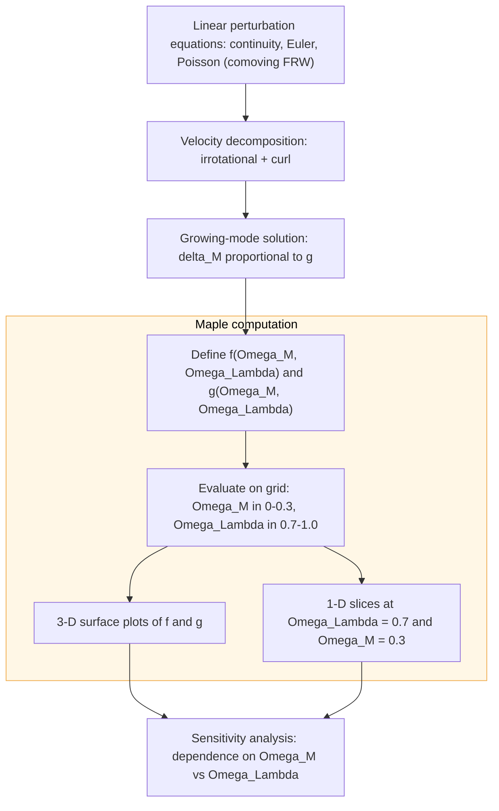
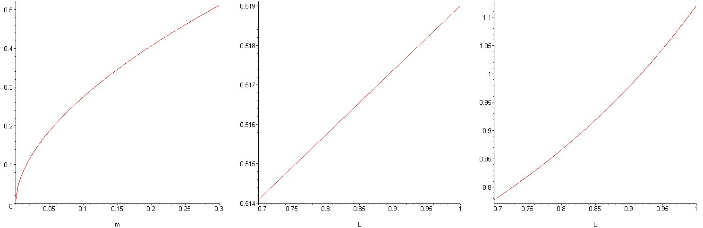

# Cosmological Growth Calculations in Maple

### Linear growth rate and growth factor of large-scale structure in a universe with a cosmological constant


Computational part of the MSc thesis **"Dark Energy and its Relation to the Cosmological Constant"**
Department of Physics, Faculty of Sciences · Bu-Ali Sina University, Hamadan, Iran · December 2008

| | |
|---|---|
| **Candidate** | Farhad Bayrami |
| **Supervisor** | Dr. A. Khodam-Mohammadi |
| **Adviser** | Dr. M. Amiri |
| **Full text** | [docs/thesis.pdf](docs/thesis.pdf) (Persian, English abstract) |

---

## Table of Contents

- [Overview](#overview)
- [Computational Problem](#computational-problem)
- [Computational Workflow](#computational-workflow)
- [Computational Setup](#computational-setup)
- [Results](#results)
- [Interpretation](#interpretation)
- [Theoretical Background](#theoretical-background)
- [Thesis Abstract](#thesis-abstract)
- [Citation](#citation)
- [Author](#author)

---

## Overview

How strongly does dark energy, in the form of a cosmological constant $\Lambda$, change the growth of cosmic structure? This project answers the question quantitatively. Starting from linear perturbation theory for pressureless matter in an expanding Friedmann–Robertson–Walker (FRW) universe, it derives closed-form expressions for the **linear growth rate** $f$ and the **linear growth factor** $g$ as functions of the matter density $\Omega_M$ and the cosmological-constant density $\Omega_\Lambda$. It then evaluates both quantities in **Maple** over a two-dimensional parameter grid and measures how sensitive each one is to $\Omega_M$ and to $\Omega_\Lambda$.

**Main computational result:** across $\Omega_\Lambda \in [0.7, 1.0]$ at $\Omega_M = 0.3$, the growth rate $f$ changes by less than 1%, while the growth factor $g$ changes by about 44%. The cosmological constant leaves the instantaneous growth rate almost untouched but has a large cumulative effect on the amplitude of structure.

---

## Computational Problem

In the linear regime ($|\delta_M| \ll 1$), the continuity, Euler and Poisson equations for pressureless matter in comoving coordinates are

$$\frac{\partial \delta_M}{\partial \tau} + \nabla\cdot\mathbf{v}_M = 0, \qquad \frac{\partial (a\,\mathbf{v}_M)}{a\,\partial\tau} = -\nabla\phi, \qquad \nabla^2\phi = \frac{3\,\Omega_M H^2 a^2}{2\,H_0^2 a_0^2}\,\delta_M$$

Splitting the peculiar velocity into irrotational and curl parts and combining the equations gives a second-order equation for $\delta_M$ whose growing mode is

$$\delta_M(\mathbf{r},\tau) \propto g(\tau), \qquad f \equiv \frac{d\ln g}{d\ln a}$$

For a universe with matter and a cosmological constant, the quantities evaluated numerically are

$$f(\Omega_M,\Omega_\Lambda) \approx \Omega_M^{\gamma} + \frac{\Omega_\Lambda}{70}\left(1 + \frac{\Omega_M}{2}\right)$$

$$g(\Omega_M,\Omega_\Lambda) \approx \frac{5\,\Omega_M}{2\left[\Omega_M^{4/7} - \Omega_\Lambda + \left(1 + \frac{\Omega_M}{2}\right)\left(1 + \frac{\Omega_\Lambda}{70}\right)\right]}$$

The growth-rate exponent is commonly quoted as $\gamma \simeq 0.6$ (Lahav et al.). The numerical evaluation uses $\gamma = 4/7$, the same exponent that appears in $g$. The growth rate connects to observations through the redshift-space distortion parameter $\beta \approx f/b$, where $b$ is the galaxy bias (Kaiser 1987).

---

## Computational Workflow



---

## Computational Setup

| Item | Setting |
|---|---|
| Software | Maple |
| Quantities computed | Linear growth rate $f(\Omega_M,\Omega_\Lambda)$ and linear growth factor $g(\Omega_M,\Omega_\Lambda)$ |
| Matter density range | $\Omega_M \in [0, 0.3]$ |
| Cosmological-constant range | $\Omega_\Lambda \in [0.7, 1.0]$ (includes flat and non-flat combinations) |
| 2-D outputs | Surface plots of $f$ and $g$ over the full grid |
| 1-D outputs | $f$ and $g$ versus $\Omega_M$ at fixed $\Omega_\Lambda = 0.7$; $f$ and $g$ versus $\Omega_\Lambda$ at fixed $\Omega_M = 0.3$ |

---

## Results

### Growth surfaces

Left: growth rate $f(\Omega_M,\Omega_\Lambda)$. Right: growth factor $g(\Omega_M,\Omega_\Lambda)$.


### One-dimensional slices

Left to right: $f$ versus $\Omega_M$ at $\Omega_\Lambda = 0.7$ · $f$ versus $\Omega_\Lambda$ at $\Omega_M = 0.3$ · $g$ versus $\Omega_\Lambda$ at $\Omega_M = 0.3$



### Computed values

| $\Omega_M$ | $\Omega_\Lambda$ | Growth rate $f$ | Growth factor $g$ |
|---|---|---|---|
| 0.1 | 0.7 | 0.279 | 0.398 |
| 0.2 | 0.7 | 0.410 | 0.618 |
| 0.3 | 0.7 | 0.514 | 0.778 |
| 0.3 | 0.85 | 0.517 | 0.919 |
| 0.3 | 1.0 | 0.519 | 1.121 |

### Sensitivity

| Variation | Change in $f$ | Change in $g$ |
|---|---|---|
| $\Omega_M$: 0.1 → 0.3 (at $\Omega_\Lambda = 0.7$) | 0.279 → 0.514 (+84%) | 0.398 → 0.778 (+96%) |
| $\Omega_\Lambda$: 0.7 → 1.0 (at $\Omega_M = 0.3$) | 0.514 → 0.519 (+0.9%) | 0.778 → 1.121 (+44%) |

---

## Interpretation

- **The growth rate is set by matter.** $f$ rises steeply with $\Omega_M$ in a power-law fashion. Along $\Omega_\Lambda$ it is a straight line starting from 0.5142 with an almost flat slope, so redshift-distortion measurements of $f$ (through $\beta$) constrain mainly $\Omega_M$.
- **The growth factor carries the imprint of $\Lambda$.** $g$ depends on $\Omega_\Lambda$ far more strongly than $f$ does, and the dependence is visibly non-linear. The cumulative amplitude of structure is therefore where the cosmological constant shows up.
- **Consequence for dark energy.** Together with the observational evidence reviewed in the thesis (Type Ia supernovae, CMB anisotropies, matter clustering, age of the universe), the calculations support the cosmological constant as the simplest consistent description of dark energy.

---

## Theoretical Background

Chapters 1 to 3 of the thesis review the background needed for the calculations.

| Chapter | Title | Content |
|---|---|---|
| 1 | Standard Cosmology | FRW universe, Hubble law, cosmological parameters, age of the universe, distance–redshift relations |
| 2 | The Cosmological Constant | Einstein field equations with $\Lambda$, evidence for an accelerating universe, interpretations of $\Lambda$ |
| 3 | Dark Energy | CMB, clustering and supernova evidence; vacuum energy versus quintessence; dark matter |
| **4** | **Linear Growth Factor** | **Redshift-space distortions, linear perturbation theory, Maple computation of $f$ and $g$ (this repository's focus)** |

---

## Thesis Abstract

In recent decades, analysis of supernova and cosmic microwave background (CMB) data has shown that about 70% of the total energy of the universe is dark. This can be described either by a cosmological constant or by a matter component with an equation of state $p = \omega\rho$. Observations indicate a total density parameter $0.98 < \Omega_{tot} < 1.08$, with $\Omega_{DE} \approx 0.70$, $\Omega_{DM} \approx 0.26$, $\Omega_{B} \approx 0.04$ and $\Omega_{R} \approx 5\times10^{-5}$ (DE: dark energy, DM: dark matter, B: baryonic matter, R: radiation). The cosmological constant problem attracted considerable attention throughout the last century. We show that the cosmological constant is the best candidate for dark energy. Another prescription describes dark energy through a scalar field known as *quintessence*, the "fifth element" of nature, which has also attracted much attention. In this research we show that the cosmological-constant prescription agrees well with observations.

---

## Citation

```bibtex
@mastersthesis{bayrami2008darkenergy,
  author = {Farhad Bayrami},
  title  = {Dark Energy and its Relation to the Cosmological Constant},
  school = {Bu-Ali Sina University, Hamadan, Iran},
  year   = {2008},
  type   = {Master's Thesis},
  note   = {Theoretical Physics. Supervisor: Dr. A. Khodam-Mohammadi; Adviser: Dr. M. Amiri. In Persian.}
}
```

All rights to the thesis belong to Bu-Ali Sina University. Any use of its content must cite the university, the supervisors and the author.

---

## Author

**Farhad Bayrami**
Email: farhad.bayrami@studio.unibo.it
[LinkedIn](https://www.linkedin.com/in/farhad-bayrami-9410a8279/) · [Google Scholar](https://scholar.google.com/citations?user=zFwyidYAAAAJ) · [GitHub](https://github.com/FarhadBayrami)
